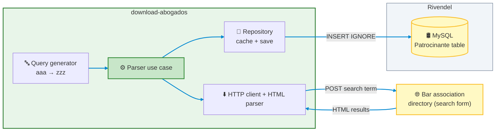

# download-abogados — Lawyer Directory Importer

[](https://github.com/leoariaspaz/download-abogados/actions/workflows/ci.yml)<sup> Latest CI run (build and tests with a coverage threshold).</sup>

A .NET console tool that downloads the public directory of registered lawyers (*matriculados*) published by a bar association and loads it into the sponsoring counsels table of **Conciliaciones (Rivendel)**, a case management platform for labor conciliators in Santiago del Estero, Argentina. It turns a web directory that can only be searched into structured data, so the catalog can be populated from the official source instead of being typed in by hand.

[Backend repo](https://github.com/leoariaspaz/rivendel) · [Frontend repo](https://github.com/leoariaspaz/rivendel-client)

## Overview

Rivendel keeps a catalog of sponsoring counsels (*patrocinantes*) that is shared by all its users, and the parties of a claim are linked to theirs. The bar association's directory is reached through a search form on its website. This tool walks that form systematically, extracts every lawyer it finds and stores the ones that are not in the catalog yet. It can be run again at any time without creating duplicates.

## Tech Stack

- **Platform:** C# on .NET 9, console application
- **HTML parsing:** HtmlAgilityPack
- **Data access:** Dapper with the MySql.Data driver
- **Database:** MySQL (the Rivendel database)
- **Testing:** xUnit, Moq and coverlet (coverage threshold enforced on every test run)
- **CI:** GitHub Actions

## Architecture



The use case depends only on three interfaces (the query generator, the directory provider and the repository), and `Program.cs` wires the concrete implementations together by hand.

## How It Works

1. The query generator produces every three-letter search term from `aaa` to `zzz`, 17,576 in total.
2. For each term, the provider posts it to the directory's search form and parses the HTML response into lawyers: name, license number, registration date, legal address, phone and email. A request that times out or fails is retried up to three times, and a search that still fails is skipped so the run can continue.
3. The repository keeps the lawyers in an in-memory cache keyed by license number, so a lawyer returned by several searches is counted once.
4. After each search, the new lawyers are saved to the Rivendel database, and a running total is printed to the console.

## Key Technical Decisions

### 1. Exhaustive enumeration of a search-only directory

The tool reaches the directory through its search form, so it does not know in advance who is registered. A deterministic generator walks every three-letter term, and the repository merges the results by license number. The trade-off is volume: 17,576 sequential requests for a full run, which is acceptable for an occasional import but would not suit anything that needs to run frequently.

### 2. Idempotent, incremental persistence

Lawyers are cached by license number and saved after every search, not at the end, so a failure halfway through a run does not lose what was already collected. The insert uses `INSERT IGNORE`, and the Rivendel table has a unique constraint on the license number, so running the tool again only adds lawyers that are not in the catalog yet. Each cached record carries a `Saved` flag so it is never sent to the database twice in the same run.

### 3. Parsing by label, not by position

Each result is a block of paragraphs such as `Nombre: …`, `Matricula: 5229 - Fecha: 10/07/2025` or `Domicilio Legal: …`. The parser identifies each field by its label, so a lawyer with no phone or email does not shift the other fields, and every field except the license number is optional in the domain model.

### 4. Layered design behind interfaces

The project follows a layered structure (controller, use case, services, data, domain) with the dependencies pointing inward. The use case can be exercised with a fake provider and a fake repository, and the source or the destination could be replaced without touching the orchestration logic. The test suite relies on exactly that: the HTTP client is injected, and the repository receives its database connections through an interface, so both can be replaced by fakes and no test needs the network or a database.

### 5. Other Technical Notes

- **Data minimization:** the phone and email are parsed but never stored. Only the name, license number and legal address reach the database.
- **Resilient requests:** a request that throws (a timeout, a connection error or any other exception) is retried up to three times with an increasing wait (2 seconds, then 4), and a search that still fails is logged and skipped instead of stopping the whole import.
- **Safe database access:** inserts use Dapper with parameterized queries.
- **Secrets out of the repository:** the connection string lives in a git-ignored `settings.txt` that is copied next to the executable at build time, and it has never been committed.

## Features

- Downloads the full lawyer directory by running 17,576 searches, from `aaa` to `zzz`
- Extracts name, license number, registration date, legal address, phone and email from each result
- Deduplicates lawyers by license number across searches
- Saves new lawyers incrementally to the Rivendel sponsoring counsels table, without creating duplicates on re-runs
- Retries failed requests with an increasing wait and skips a search that keeps failing
- Reports progress and the final total in the console
- Unit and integration tests with an enforced coverage threshold, run by a GitHub Actions workflow

## Project Structure

```text
download-abogados/
├─ .github/workflows/
│  └─ ci.yml                              # Build and test on every push to main
├─ DownloadAbogados/
│  ├─ Controllers/
│  │  └─ ScraperController.cs             # Entry point that starts the import
│  ├─ UseCases/
│  │  ├─ IParser.cs                       # Use case contract
│  │  └─ MatriculadosParser.cs            # Orchestrates search, parsing and saving
│  ├─ Services/
│  │  ├─ IQueryCriteriaGenerator.cs       # Search term generator contract
│  │  ├─ QueryCriteriaGenerator.cs        # Generates the terms from aaa to zzz
│  │  ├─ IMatriculadosProvider.cs         # Directory provider contract
│  │  ├─ DownloaderHttpClient.cs          # Posts the search and parses the HTML result
│  │  └─ CustomHttpClient.cs              # Shared HTTP client and retry helper
│  ├─ Data/
│  │  ├─ DTOs/MatriculadoDTO.cs           # Lawyer plus a "saved" flag
│  │  ├─ IMatriculadosRepository.cs       # Repository contract
│  │  ├─ IMySqlConnectionFactory.cs       # Connection factory contract
│  │  ├─ MatriculadosRepository.cs        # In-memory cache and database insert
│  │  └─ MySqlConnectionFactory.cs        # Opens MySQL connections
│  ├─ Domain/
│  │  └─ Matriculado.cs                   # Lawyer entity
│  ├─ DownloadAbogados.csproj             # Project file
│  └─ Program.cs                          # Composition root
├─ DownloadAbogados.Tests/
│  ├─ Controllers/                        # Controller tests
│  ├─ Data/                               # Repository and connection factory tests
│  ├─ Domain/                             # Entity and DTO tests
│  ├─ Integration/                        # Downloader and parser working together
│  ├─ Services/                           # Query generator and HTTP client tests
│  ├─ Support/                            # Fake HTTP handler and recording database connection
│  ├─ UseCases/                           # Import use case tests
│  └─ DownloadAbogados.Tests.csproj       # Test project and coverage threshold
├─ DownloadAbogados.sln                   # Solution
└─ .gitignore                             # Includes settings.txt
```

## Getting Started

### Prerequisites

- .NET 9 SDK
- A MySQL database with the Rivendel schema applied (see the [backend repo](https://github.com/leoariaspaz/rivendel)), since the tool writes to its `Patrocinante` table

### Configuration

Create a `settings.txt` file inside the `DownloadAbogados` folder with a MySQL connection string on a single line. The file is ignored by git. The insert statement refers to the `rivendel` database and the `Patrocinante` table explicitly, so the connection must be able to write there. The file is only needed to run the importer, not to build the solution or to run the tests.

### Running

```bash
cd DownloadAbogados
dotnet run
```

## Testing

The test suite runs on **xUnit** with **Moq** and **coverlet**, and has 28 test cases. No test needs the network or a database: a fake HTTP handler returns canned directory pages, and a recording database connection captures the commands the repository sends. The tests cover the search term generator over its whole range, the parsing of every field, the retry and give-up behavior, the deduplication and saved-flag logic of the repository, the use case when a search or a save fails, and an integration test that runs the real downloader and parser against a fake HTTP response.

Coverage is collected on every test run and a threshold of 91% (lines, branches and methods, `Program.cs` excluded) makes the run fail if it drops below that.

```bash
dotnet test      # run once, with the coverage threshold check
```

The same build and test steps run in GitHub Actions on every push to `main`, and the badge at the top of this file shows the result of the latest run.

## Related Repositories

This tool feeds the sponsoring counsels shared across users in the Rivendel project. :link: [Backend](https://github.com/leoariaspaz/rivendel) (NestJS) · :link: [Frontend](https://github.com/leoariaspaz/rivendel-client) (React + Vite)

## Roadmap

- Update existing sponsoring counsels when the directory changes, since `INSERT IGNORE` only adds new lawyers and never modifies existing rows.
- Add a configurable delay between requests, and retry transient HTTP error statuses (for example 5xx), which are currently logged and skipped; only requests that throw an exception are retried today.
- Add parser tests against saved HTML fixtures of the real directory page, so a change in the site's markup is caught early.
- Make the target database and table configurable instead of hard-coding `rivendel.Patrocinante`.

## License

This project is publicly available for viewing and educational purposes only.
No permission is granted to use, modify, or distribute this code without explicit authorization.
